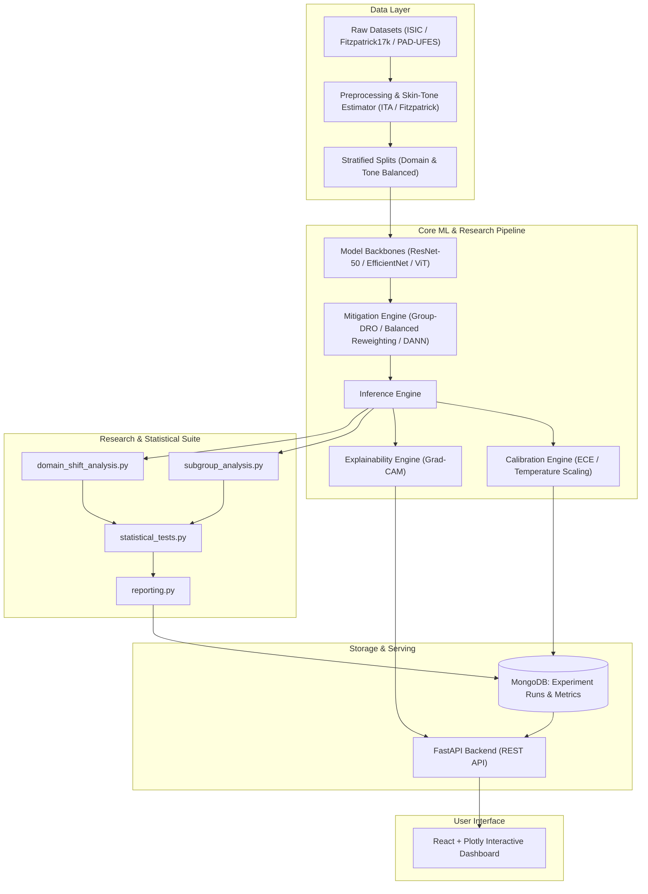

# System and Research Architecture

This document details the modular software and machine learning architecture for the **Bias and Domain Shift in Skin-Lesion Classification** system.

---

## 1. High-Level System Architecture

The architecture consists of three interconnected layers:
1. **Machine Learning & Research Core (`src/`)**: PyTorch-based training, domain adaptation, calibration, explainability, and statistical disparity testing.
2. **Serving & Analytics Backend (`backend/`)**: FastAPI application providing inference endpoints, Grad-CAM generation, and MongoDB query services for evaluation benchmarks.
3. **Interactive Analytical Dashboard (`frontend/`)**: React dashboard utilizing Plotly to render subgroup disparities, calibration curves, and Grad-CAM overlays.

---

## 2. Core Machine Learning Modules (`src/`)

### 2.1 Dataset Ingestion & Tone Classification (`src/datasets/`)
- **`base.py`**: Abstract dataset base class standardizing image loading, metadata parsing, and ground-truth formatting.
- **Tone Estimation**: Computes the **Individual Typology Angle (ITA)** from unlesioned surrounding skin regions in CIE $L^*a^*b^*$ color space:
  $$\text{ITA} = \arctan\left(\frac{L^* - 50}{b^*}\right) \times \frac{180}{\pi}$$
  Categorizes continuous ITA values into standard dermatological buckets: Very Light ($>55^\circ$), Light ($41^\circ\text{ to }55^\circ$), Intermediate ($28^\circ\text{ to }41^\circ$), Tan ($10^\circ\text{ to }28^\circ$), Brown ($-30^\circ\text{ to }10^\circ$), and Dark ($<-30^\circ$).

### 2.2 Model Architectures (`src/models/`)
- Standardized CNN and Vision Transformer backbones with interchangeable classification heads.
- Feature extraction interfaces designed to extract bottleneck representations for domain adaptation and Grad-CAM computation.

### 2.3 Fairness Mitigation & Domain Adaptation (`src/mitigation/`)
- **Group-Reweighted Empirical Risk Minimization**: Penalizes underrepresented skin tones and rare classes proportionally.
- **Group Distributionally Robust Optimization (Group-DRO)**: Minimizes worst-group risk rather than average empirical risk.
- **Domain Adversarial Feature Alignment (DANN)**: Employs a gradient reversal layer (GRL) to learn domain-invariant representations across dermoscopic vs. clinical inputs.

### 2.4 Calibration & Uncertainty (`src/evaluation/calibration.py`)
- Calculates **Expected Calibration Error (ECE)** and **Maximum Calibration Error (MCE)** partitioned by skin-tone subgroup:
  $$\text{ECE} = \sum_{m=1}^{M} \frac{|B_m|}{N} \left| \text{acc}(B_m) - \text{conf}(B_m) \right|$$
- Post-hoc calibration using temperature scaling applied per subgroup and across domain shifts.

### 2.5 Explainability & Grad-CAM (`src/explainability/`)
- Computes gradient-weighted class activation mappings:
  $$L_{\text{Grad-CAM}}^c = \text{ReLU}\left(\sum_k \alpha_k^c A^k\right)$$
- Evaluates bounding-box intersection-over-union (IoU) of activations against lesion segmentation masks to detect reliance on artifacts (hair, markers, borders).

---

## 3. Research & Statistical Suite (`src/research/`)

- **`subgroup_analysis.py`**: Computes granular disaggregated performance metrics (AUROC, sensitivity at fixed specificity, equalized odds ratio, false positive/negative rate parity) across Fitzpatrick skin tones and ITA brackets.
- **`domain_shift_analysis.py`**: Computes performance retention curves and covariate shift metrics when models trained on source domain $\mathcal{D}_S$ (e.g., dermoscopy) are evaluated on target domain $\mathcal{D}_T$ (e.g., clinical photography).
- **`statistical_tests.py`**: Implements non-parametric bootstrap confidence intervals (e.g., 95% BCa bootstrap), permutation tests for subgroup disparity significance, and DeLong's test for comparing ROC curves.
- **`reporting.py`**: Generates automated markdown and LaTeX summary tables as well as structured JSON payloads for frontend consumption.

---

## 4. Serving & Persistence Layer

- **FastAPI (`backend/app/`)**:
  - `/api/predict`: Returns diagnostic probabilities, uncertainty intervals, and skin-tone classification.
  - `/api/explain`: Computes on-the-fly Grad-CAM heatmaps overlaid on the input lesion.
  - `/api/benchmarks`: Retrieves stored statistical metrics, calibration curves, and subgroup disparity scores.
- **MongoDB Schema**:
  - `experiments`: Stores run configurations, git commit hashes, hyperparameters, and dataset splits.
  - `evaluations`: Stores disaggregated subgroup metrics, ECE arrays, and confusion matrices.
  - `audit_logs`: Stores runtime timestamps, model version references, and execution metadata.

---

## 5. Interactive Frontend (`frontend/`)

- Built with React and Vite.
- Visualizations powered by Plotly.js:
  - Disparity Radar Charts (Fairness metrics across Fitzpatrick I–VI).
  - Reliability Diagrams (Confidence vs. Accuracy with ECE bars per skin tone).
  - Domain Shift Transfer Matrices (Source $\to$ Target performance drops).
  - Interactive Grad-CAM inspection viewer with adjustable threshold and alpha blending.
